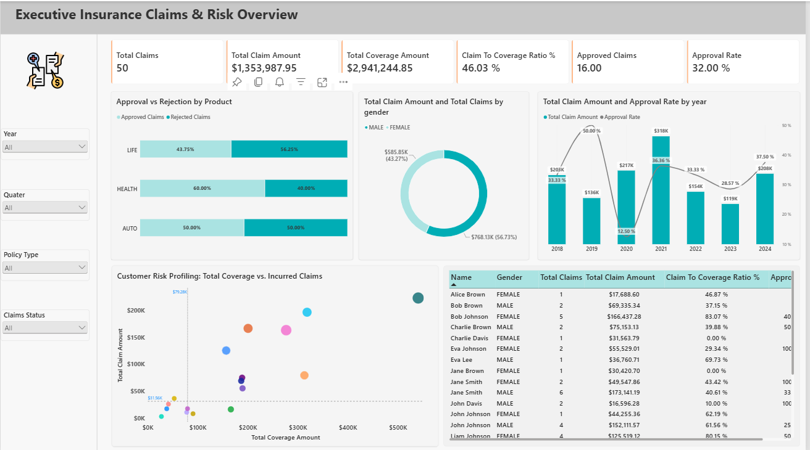

# End-to-End Insurance Claims KPI & Risk Analytics (Microsoft Fabric)

An enterprise insurance lakehouse and Direct Lake analytics solution built using **Microsoft Fabric**, **PySpark**, **Delta Lake**, and **Power BI**. 

This platform ingests raw customer, policy, and claims transactions from Azure Blob Storage, processes data through a Medallion architecture, and exposes a Direct Lake semantic model for real-time customer risk profiling and claims underwriting performance.

---

## Architecture Diagram

[Azure Blob Storage (CSV)]
│
▼
[Fabric Data Factory Pipeline: pl_insurance_data_ingestion]
│
▼
[Lakehouse Raw: lh_insurance_raw (Bronze Delta)]
│
▼ (nb_bronze_to_silver_insurance - PySpark)
[Lakehouse Silver: lh_insurance_silver (Cleaned / Typed / Standardized)]
│
▼ (nb_silver_to_gold_insurance - PySpark Dimensional Model)
[Lakehouse Gold: lh_insurance_gold (Star Schema Delta Tables)]
├── dbo.gold_dim_customer
├── dbo.gold_dim_policy
├── dbo.gold_dim_date
└── dbo.gold_fct_claims
│
▼
[Semantic Model: insurance_kpis_analytics (Direct Lake on OneLake)]
│
▼
[Power BI Report: insurance_analytics_report]

---

## Workspace Inventory & Components

| Asset Name | Type | Description |
| :--- | :--- | :--- |
| `pl_insurance_data_ingestion` | Data Pipeline | Copy Data activity pulling raw CSV payloads into Bronze tables |
| `lh_insurance_raw` | Lakehouse (Bronze) | Raw storage for customer, policy, and claims data |
| `nb_bronze_to_silver_insurance` | PySpark Notebook | Schema enforcement, null sanitization, status code standardization |
| `lh_insurance_silver` | Lakehouse (Silver) | Validated, cleansed tabular Delta layer |
| `nb_silver_to_gold_insurance` | PySpark Notebook | Builds Star Schema tables and auto-generates sequential date dimension |
| `lh_insurance_gold` | Lakehouse (Gold) | Conformed Fact (`gold_fct_claims`) & Dimensions (`customer`, `policy`, `date`) |
| `nb_gold_analytics_insights` | PySpark Notebook | Validation queries, customer risk profiling aggregations, baseline metrics |
| `insurance_kpis_analytics` | Semantic Model | Direct Lake mode on OneLake with 1:* single-direction relationships |
| `insurance_analytics_report` | Power BI Report | Executive dashboard for risk profiling, loss exposure, and claims operations |

---

## Data Model & Relationships

The reporting layer operates on an optimized dimensional Star Schema:
* `dbo.gold_dim_customer[cust_id]` (1) ───< `dbo.gold_fct_claims[cust_id]` (*)
* `dbo.gold_dim_policy[policy_id]` (1) ───< `dbo.gold_fct_claims[policy_id]` (*)
* `dbo.gold_dim_date[date]` (1) ───< `dbo.gold_fct_claims[claim_date]` (*)

---
## Dashboard Preview



## Core DAX Business Logic

```dax
// Total Incurred Claim Volume
Total Claims = COUNTROWS('gold_fct_claims')

// Total Incurred Payouts
Total Claim Amount = SUM('gold_fct_claims'[claim_amount])

// Aggregated Customer Coverage Exposure
Total Coverage Amount = SUM('gold_dim_policy'[coverage_amount])

// Underwriting Loss Exposure
Claim to Coverage Ratio = 
DIVIDE([Total Claim Amount], [Total Coverage Amount], 0)

// Operational Approval Throughput (Coalesced to eliminate null blanks)
Approved Claims = 
COALESCE(
    CALCULATE(
        COUNTROWS('gold_fct_claims'), 
        'gold_fct_claims'[claim_status] = "APPROVED"
    ), 
    0
)

Approval Rate = 
DIVIDE([Approved Claims], [Total Claims], 0)

